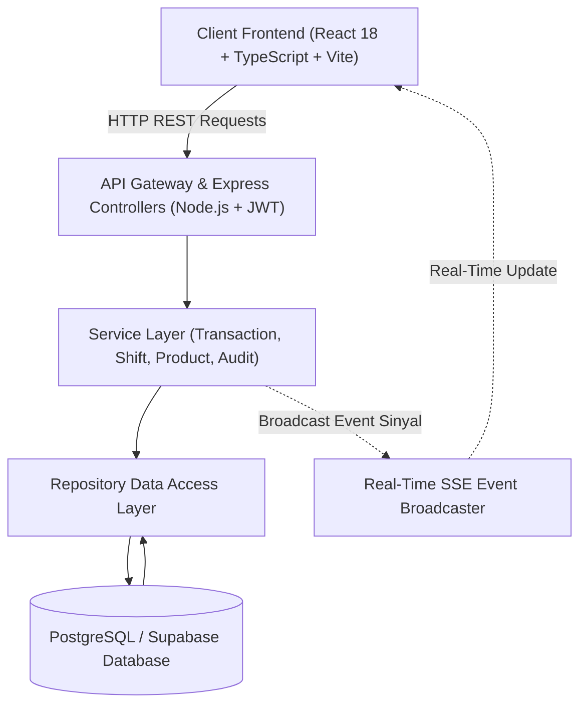

# 🏪 ShiftMaster POS — Sistem Kasir Usaha Campuran
> **Platform Kasir & Operasional Bisnis Hybrid (FC/Printing & F&B) dengan Sinkronisasi Real-Time Multi-Device**

[](./CHANGELOG.md)
[](https://react.dev/)
[](https://www.typescriptlang.org/)
[](https://nodejs.org/)
[](https://expressjs.com/)
[](https://www.postgresql.org/)
[](https://developer.mozilla.org/en-US/docs/Web/CSS)
[](https://vitejs.dev/)
[]()

---

## 📌 Ringkasan Eksekutif

**ShiftMaster POS** adalah sistem kasir Point of Sale modern yang dirancang khusus untuk memenuhi kompleksitas operasional **usaha campuran (hybrid business)**, seperti:
- **Divisi Jasa & FC/Printing:** Fotokopi lembaran, print dokumen warna/BW, scan, laminasi, ATK, jasa ketik, dan desain grafis.
- **Divisi Food & Beverage (F&B):** Mie instan olahan/masak, snack, gorengan, seblak, es krim, kopi, dan aneka minuman dingin/hangat.

Sistem ini memecahkan kendala klasik pencatatan manual: kebocoran kas laci, kekeliruan perhitungan stok barang fisik vs jasa, pelacakan kasir saat multi-karyawan bertugas bersama, serta pemantauan omzet jarak jauh secara akurat dan real-time oleh pemilik usaha (*Owner*).

---

## 🌟 Pilar Fitur Unggulan

### 1. 🍲 Sistem Racikan Dinamis & Pemotongan Multi-Bahan (*Product Modifiers*)
- **Single Master Stock fisik:** Tidak perlu membuat produk ganda (*"Indomie Mentah"* vs *"Indomie Masak"*). Toko hanya menyimpan 1 master stok fisik mie bungkus di rak.
- **Opsi Olahan & Topping Fleksibel:** Kasir dapat memilih opsi cara saji (Goreng/Kuah/Matang/Mentah) serta topping tambahan (Telur Ayam, Sosis, Keju, Kornet, Level Pedas).
- **Pemotongan Stok Bahan Baku Otomatis:** Saat transaksi selesai, sistem memotong stok mie sekaligus stok bahan baku topping dari etalase toko secara terhubung (*linked stock*).
- **Proteksi Pengembalian Stok:** Pembatalan nota (*void*) otomatis mengembalikan seluruh stok produk utama beserta bahan baku topping ke etalase.

### 2. ⚡ Antarmuka Kasir Cepat (*Rapid POS Register*)
- **Zero-Friction Checkout:** Produk ritel biasa (bolpoin, buku, air mineral) langsung 1-klik masuk ke keranjang kasir tanpa popup berlebih.
- **Panel Keranjang & Pembayaran Tetap (*Sticky Panel*):** Ketika kasir menggulir ratusan daftar produk ke bawah, panel rincian pesanan, total tagihan, dan tombol pembayaran tetap tersemat di sisi kanan layar (tidak ikut tergulung hilang ke atas).
- **Toolbar Pencarian & Kategori Cepat:** Kolom pencarian dinamis dengan tombol reset instan (X) serta filter dropdown kategori yang ringkas.
- **Metode Pembayaran Lengkap:** Mendukung Tunai/Cash (kalkulasi kembalian otomatis), QRIS dinamis, dan Transfer Bank.
- **Pewarnaan Kontekstual Badge:** Indikator visual pintar memudahkan kasir membedakan pesanan olahan hangat (Hijau), kemasan mentah (Biru), topping ekstra (Kuning), pedas (Merah), dan es dingin (Cyan).

### 3. 👥 Sistem Sesi Shift Kasir & Rekonsiliasi Kas Akurat
- **Multi-Petugas per Shift:** Mendukung beberapa kasir bertugas bersama dalam satu sesi shift tanpa batasan kaku.
- **Transparansi Kas Masuk & Kas Keluar:** Mencatat modal kas awal (*drawer capital*), pemasukan operasional, dan pengeluaran darurat warung/toko.
- **Rekonsiliasi Kas Otomatis:** Menghitung kas teoritis akhir vs kas fisik riil di laci saat tutup shift, mengeliminasi risiko selisih kas tanpa jejak.
- **Pencatatan Nota & Void Bertingkat:** Riwayat nota shift dapat dicetak ulang atau dibatalkan oleh petugas berwenang dengan audit trail lengkap.

### 4. 📦 Manajemen Stok & Inventori Bersama (*Shared Inventory Pool*)
- **Pemisahan Stok Etalase vs Gudang:** Mendukung mutasi barang dari gudang penyimpanan ke rak kasir depan.
- **Dynamic Linked Stock:** Produk varian berbeda dapat berbagi pool stok fisik yang sama tanpa duplikasi pencatatan stok.
- **Item Non-Stok untuk Jasa:** Jasa fotokopi, ketik, dan desain beroperasi tanpa kendala pembatasan stok.

### 5. 📊 Dashboard Analitik Owner & Laporan Komprehensif
- **Pemantauan Omzet Real-Time:** Owner dapat memantau pergerakan penjualan toko dari mana saja melalui smartphone atau laptop.
- **Analisis Kategori & Perputaran Barang:** Memisahkan omzet FC/Print vs F&B, menghitung ranking produk terlaris (*Fast-Moving*), serta mendeteksi produk dengan perputaran lambat (*Slow-Moving*).
- **Cetak Struk Thermal & Ekspor Rekapitulasi:** Mendukung pencetakan struk printer thermal 58mm/80mm, invoice faktur A4, dan ekspor laporan shift ke lembar kerja Excel (.xlsx).

### 6. 🛡️ Keamanan Enterprise, Hak Akses (RBAC) & Audit Log
- **Role-Based Access Control (RBAC):** Pemisahan hak akses yang ketat antara **Owner** (akses penuh analitik, data produk, pegawai, dan backup) dan **Kasir Operasional** (terfokus pada penjualan dan shift).
- **Tamper-Proof Audit Log:** Seluruh aktivitas penting (perubahan harga, penghapusan produk, void nota, penutupan shift) tercatat permanen di audit log dan tidak dapat dimanipulasi oleh staf biasa.
- **Keamanan Kredensial:** Otentikasi berbasis JWT, hashing kata sandi dengan Bcrypt, serta isolasi seluruh kunci API di environment variable backend.

### 7. 💾 Pencadangan & Pemulihan Data (*Backup & Restore*)
- **Snapshot Cadangan Terenkripsi:** Unduh snapshot seluruh data transaksi, produk, dan riwayat sistem dalam format JSON kapan saja.
- **Restore Instan:** Mekanisme pemulihan data yang aman untuk mencegah *data loss* saat migrasi perangkat.

---

## 🏗️ Arsitektur Sistem & Teknologi

Sistem dirancang dengan arsitektur modular **Service-Repository Pattern** yang memudahkan integrasi dan pemeliharaan:



| Komponen | Teknologi | Keterangan |
| :--- | :--- | :--- |
| **Frontend Framework** | React 18, TypeScript, Vite | Antarmuka interaktif, SPA ringan, zero compile lag |
| **Styling Engine** | Vanilla Modern CSS, HSL Tokens | Scroll halus, scrollbar ramping 6px, tema adaptif |
| **Icons & Media** | Lucide React | HD Retina-ready vector icons (2.2px stroke) |
| **Backend Runtime** | Node.js, Express.js, TypeScript | RESTful API terstruktur dan type-safe |
| **Otentikasi & Keamanan** | JSON Web Token (JWT), Bcrypt | Enkripsi kata sandi dan proteksi endpoint API |
| **Database** | PostgreSQL / Supabase Cloud DB | Relasional ACID, dukungan query JSONB & GIN Index |
| **Real-Time Sync** | Server-Sent Events (SSE) | Sinkronisasi multi-device otomatis tanpa polling |

### 💻 Komposisi Bahasa Pemrograman & Ekosistem Codebase
Berdasarkan analisis statistik repositori GitHub Linguist dan arsitektur proyek:

| Bahasa / Framework | Porsi / Peran | Kegunaan dalam Sistem |
| :--- | :--- | :--- |
| **React 18** | UI Framework (Frontend) | Komponen UI reaktif, modal racikan dinamis, sticky register kasir |
| **TypeScript** | **95.6%** (Bahasa Utama) | Type safety 100% pada logika bisnis frontend (`.tsx`) dan backend REST API (`.ts`) |
| **Modern CSS3** | **3.3%** (Styling Engine) | Desain Vanilla CSS murni, smooth scrolling, scrollbar ramping 6px, tema adaptif |
| **PLpgSQL / SQL** | **1.1%** (Database Schema) | Migrasi relasional PostgreSQL, constraint integritas kasir, JSONB modifiers |
| **Node.js & Express** | Runtime & API Gateway | Penanganan REST API, validasi data, SSE broadcaster, kalkulasi stok |
| **Vite** | Build Tooling | Bundler frontend ultra-cepat dengan Hot Module Replacement (HMR) |

---

## 📂 Struktur Repositori

```text
Pos_Kasir/
├── client/                     # Frontend Application (React + TypeScript)
│   ├── src/
│   │   ├── components/         # Reusable UI Components & Layouts
│   │   ├── pages/              # Halaman Dashboard, Kasir, Stok, Laporan
│   │   ├── services/           # API Client Service & Offline Sync Engine
│   │   └── utils/              # Formatter Rupiah, Modifier Badges, Print Engine
│   └── package.json
├── server/                     # Backend API Server (Express + TypeScript)
│   ├── src/
│   │   ├── controllers/        # Request Handlers & Input Validators
│   │   ├── services/           # Core Business Logic & Stock Calculation
│   │   ├── repositories/       # Database Query & Data Access Layer
│   │   └── database/           # Skema Migrasi SQL (001 - 009)
│   └── package.json
├── docs/                       # Dokumentasi Teknis Lengkap Proyek
│   ├── PRD.md                  # Product Requirement Document
│   ├── ARCHITECTURE.md         # Cetak Biru Arsitektur Sistem
│   ├── ERD.md                  # Entity Relationship Diagram
│   ├── RBAC.md                 # Matriks Hak Akses Pengguna
│   └── CHANGELOG.md            # Riwayat Pembaruan Detail
├── AGENTS.md                   # Panduan & Prinsip Utama Tata Kelola AI Agent
├── docker-compose.yml          # Konfigurasi Kontainerisasi Docker
└── README.md                   # Dokumentasi Utama Repositori
```

---

## 🚀 Panduan Penerapan (Deployment)

### Kontainerisasi Menggunakan Docker
Aplikasi telah dilengkapi konfigurasi Docker Compose untuk proses deployment produksi yang aman dan terisolasi:

```bash
docker-compose up -d --build
```
*Layanan backend dan frontend akan aktif berjalan secara kontainerisasi di port yang telah dikonfigurasi pada file environment (`.env`).*

> [!IMPORTANT]
> Seluruh kredensial administratif, kunci koneksi database, dan token rahasia JWT wajib didefinisikan secara mandiri melalui berkas konfigurasi `.env` di lingkungan deployment dan tidak boleh dicatat secara terbuka di source code publik.

---

## 📜 Kepatuhan & Standar Kualitas

Pengembangan sistem POS ini tunduk pada aturan ketat yang terdokumentasi pada **[AGENTS.md](./AGENTS.md)**:
- **Zero Business Logic Hardcoding:** Seluruh data produk, harga, karyawan, dan aturan komputasi wajib bersumber dari sistem data.
- **Integritas Transaksi:** Data transaksi yang telah selesai bersifat abadi dan tidak dapat dihapus secara permanen (*soft-delete/void audit only*).
- **Prioritas Keamanan:** Keamanan data dan kebenaran rekonsiliasi kas selalu diprioritaskan di atas kecepatan pengembangan sesaat.

---

## 📄 Lisensi
Hak Cipta © 2026 ShiftMaster POS. Seluruh hak cipta dilindungi undang-undang.
Dikembangkan secara bertahap dan terdokumentasi untuk keandalan operasional bisnis nyata.
